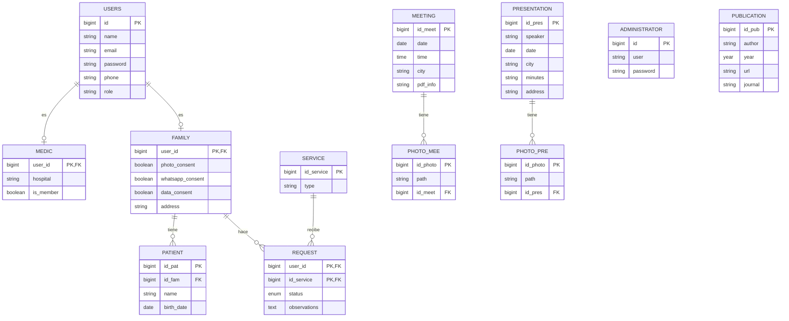

# Base de datos

Estructura de la base de datos del proyecto, definida mediante migraciones de Laravel en `database/migrations/`.

## Puesta en marcha

El proyecto usa MySQL (MariaDB de XAMPP) en lugar de SQLite, que es el motor por defecto de Laravel 13. La base de datos se gestiona desde phpMyAdmin.

### Requisitos

- XAMPP para Linux instalado en `/opt/lampp`
- PHP 8.3 o superior en el sistema (es el que usa `php artisan`, no el de XAMPP)
- Extensión `pdo_mysql` para PHP
- Composer

### 1. Instalar dependencias del sistema

XAMPP necesita `netstat` para arrancar, que viene en `net-tools`:

```bash
sudo apt update
sudo apt install net-tools
```

Instalar la extensión de MySQL para PHP (ajustar la versión según `php -v`):

```bash
sudo apt install php8.5-mysql
```

Comprobar que está cargada:

```bash
php -m | grep -i pdo_mysql
```

### 2. Liberar el puerto 80

Si el sistema tiene Apache instalado, ocupa el puerto 80 y el Apache de XAMPP no arranca. Para pararlo y evitar que se inicie con el sistema:

```bash
sudo systemctl stop apache2
sudo systemctl disable apache2
```

### 3. Arrancar XAMPP

```bash
sudo /opt/lampp/lampp start
```

Otros comandos útiles:

```bash
sudo /opt/lampp/lampp stop
sudo /opt/lampp/lampp restart
sudo /opt/lampp/lampp status
```

### 4. Crear la base de datos

1. Entrar en `http://localhost/phpmyadmin` (usuario `root`, sin contraseña por defecto).
2. Pulsar **Nueva** en la columna izquierda.
3. Nombre: `intranet_lald`. Cotejamiento: `utf8mb4_unicode_ci`.
4. Pulsar **Crear**.

### 5. Configurar el `.env`

```dotenv
DB_CONNECTION=mysql
DB_HOST=127.0.0.1
DB_PORT=3306
DB_DATABASE=intranet_lald
DB_USERNAME=root
DB_PASSWORD=

SESSION_DRIVER=database
CACHE_STORE=database
QUEUE_CONNECTION=database
```

`DB_CONNECTION` es el tipo de conexión (`mysql`), no el nombre de la base de datos. El nombre va en `DB_DATABASE`.

### 6. Crear las tablas

Desde la raíz del proyecto, para crear (o recrear desde cero) todas las tablas:

```bash
php artisan config:clear
php artisan migrate:fresh
```

Para cargar también los datos de prueba:

```bash
php artisan migrate:fresh --seed
```

Al recargar phpMyAdmin aparecerán las tablas en `intranet_lald`.

### Problemas frecuentes

| Error                                            | Causa                                     | Solución                                                      |
| ------------------------------------------------ | ----------------------------------------- | ------------------------------------------------------------- |
| `netstat: orden no encontrada` al arrancar XAMPP | Falta `net-tools`                         | `sudo apt install net-tools`                                  |
| Apache de XAMPP da `fail`                        | Puerto 80 ocupado por `apache2`           | `sudo systemctl stop apache2`                                 |
| `could not find driver` al migrar                | Falta `pdo_mysql` en el PHP del sistema   | `sudo apt install php8.5-mysql`                               |
| `Database connection [...] not configured`       | Nombre de la BD puesto en `DB_CONNECTION` | Poner `mysql` en `DB_CONNECTION` y el nombre en `DB_DATABASE` |

## Diagrama



## Migraciones

Todas las tablas incluyen `created_at` y `updated_at`, que Laravel rellena automáticamente, salvo las tablas internas que lo indican.

### Tablas internas de Laravel

**`0001_01_01_000000_create_users_table.php`**
Crea tres tablas. `users` almacena los usuarios de la aplicación: `id`, `name`, `email` (único), `email_verified_at`, `password`, `phone`, `role` y `remember_token`, que sirve para la opción "recordarme" del login. `password_reset_tokens` guarda los códigos temporales para recuperar la contraseña por email. `sessions` guarda las sesiones activas de los usuarios.

**`0001_01_01_000001_create_cache_table.php`**
Crea `cache`, donde Laravel guarda datos temporales para no tener que recalcularlos, y `cache_locks`, que evita que dos procesos modifiquen el mismo dato de la caché a la vez.

**`0001_01_01_000002_create_jobs_table.php`**
Crea las tablas de la cola de tareas en segundo plano. `jobs` contiene las tareas pendientes, `job_batches` agrupa varias tareas para controlar cuándo terminan todas y `failed_jobs` registra las que han fallado, con el error correspondiente.

### Usuarios y familias

**`create_administrator_table.php`**
Crea `administrator`, con los administradores de la aplicación: `id`, `user` y `password`.

**`create_medic_table.php`**
Crea `medic`, con los médicos. Su clave primaria es `user_id`, que a la vez es clave foránea hacia `users`: cada médico es un usuario (relación 1:1). Incluye `hospital` e `is_member`, un booleano que indica si pertenece a la entidad. Si se borra el usuario, se borra también el médico.

**`create_family_table.php`**
Crea `family`, con las familias. Igual que `medic`, su clave primaria es `user_id`, que también es clave foránea hacia `users` (relación 1:1). Incluye tres consentimientos booleanos (`photo_consent`, `whatsapp_consent` y `data_consent`) y `address`.

**`create_patient_table.php`**
Crea `patient`, con los pacientes. Clave primaria `id_pat` y clave foránea `id_fam` hacia `family`: una familia puede tener varios pacientes (relación 1:N). Incluye `name` y `birth_date`.

### Servicios

**`create_service_table.php`**
Crea `service`, con los servicios que ofrece la entidad: clave primaria `id_service` y `type`.

**`create_request_table.php`**
Crea `request`, con las solicitudes de servicios. Es la tabla intermedia de la relación N:M entre `family` y `service`: tiene una clave foránea `user_id` hacia `family` y otra `id_service` hacia `service`, y las dos juntas forman la clave primaria compuesta. Incluye `status` (`pending`, `accepted` o `rejected`, por defecto `pending`) y `observations` (opcional). Se ejecuta después de `service` porque depende de ella.

### Encuentros, presentaciones y publicaciones

**`create_meeting_table.php`**
Crea `meeting`, con las trobades (encuentros): clave primaria `id_meet`, `date`, `time`, `city` y `pdf_info`, que guarda la ruta a un PDF informativo y es opcional.

**`create_photo_mee_table.php`**
Crea `photo_mee`, con las fotos de los encuentros: clave primaria `id_photo`, `path` (ruta de la imagen) y clave foránea `id_meet` hacia `meeting`. Un encuentro puede tener varias fotos (relación 1:N); si se borra el encuentro, se borran sus fotos.

**`create_presentation_table.php`**
Crea `presentation`, con las presentaciones: clave primaria `id_pres`, `speaker` (ponente), `date`, `city`, `minutes` (ruta del acta, opcional) y `address`.

**`create_photo_pre_table.php`**
Crea `photo_pre`, con las fotos de las presentaciones: clave primaria `id_photo`, `path` y clave foránea `id_pres` hacia `presentation`. Una presentación puede tener varias fotos (relación 1:N); si se borra la presentación, se borran sus fotos.

**`create_publication_table.php`**
Crea `publication`, con las publicaciones: clave primaria `id_pub`, `author`, `year`, `url` y `journal` (revista, opcional).
